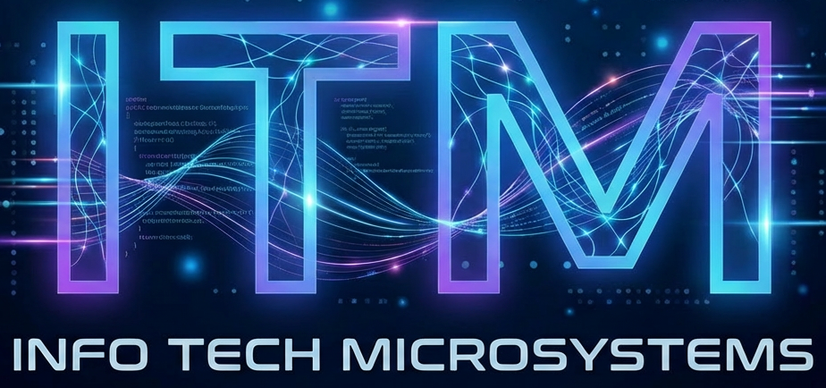

<div align="center">
  
  <h1>INFO TECH MICROSYSTEMS</h1>
  <p><b>Enterprise Software Engineering, Architectural Advisory, QA Automation & KPI Governance</b></p>
  <p>
    <a href="https://react.dev/"></a>
    <a href="https://vite.dev/"></a>
    <a href="https://www.typescriptlang.org/"></a>
    <a href="https://tailwindcss.com/"></a>
    <a href="https://dexie.org/"></a>
    <a href="docs/globalization_guide.md"></a>
    <a href="docs/accessibility_guide.md"></a>
    <a href="docs/LICENSE.md"></a>
  </p>
</div>

<br />

Welcome to the official repository for **INFO TECH MICROSYSTEMS (ITM)**. Headquartered in Canada's technology capital (**Ottawa, Ontario**), INFO TECH MICROSYSTEMS was founded by Principal Technology Consultant **Sudarsha Wijenayake** to bridge the critical gap between executive technology strategy and production-grade software delivery.

This web application combines corporate service specifications with an offline-first **Enterprise KPI Telemetry Engine** powered by client-side IndexedDB, offering interactive engineering calculators, DORA velocity assessments, and full globalization across 11 international languages.

> [!NOTE]
> All telemetry and data querying on this platform are performed entirely within the user's browser using a deterministic **IndexedDB** database engine (Dexie.js). No external backend dependencies or network trackers are required to explore the full depth of the analytics platform.

---

## ✨ Key Platform Features

- 🏛️ **7 Enterprise Service Disciplines**: Detailed capabilities, 4-step delivery lifecycles, and architectural specifications for Custom Software Development, Strategic Advisory, Workforce Training, Quality Assurance, Talent Recruitment, KPI Process Audits, and Personnel Performance Management.
- 📊 **Browser-Native KPI Telemetry Engine**: Live IndexedDB analytical database pre-seeded with 2,500+ work items, 4,000+ test executions, and 120+ release cycles across 6 distinct perspectives (*Executive*, *Quality*, *Risk*, *Automation*, *Productivity*, *Governance*).
- 🧮 **Interactive Engineering Tools**:
  - **DORA & Velocity Health Calculator**: Evaluates Deployment Frequency, Lead Time, CFR, and MTTR with dynamic tier classification (Elite to Low) and actionable recommendations.
  - **QA Strategy & Architecture Audit Matrix**: 24-point verification matrix across Architecture, QA, Security, and Governance with instant clipboard export.
  - **Squad Capacity Modeling**: Live estimation of sprint throughput and dev-to-QA staffing balance.
  - **Core KPI Reference Directory**: Mathematical formulas, DORA target benchmarks, and business ROI justifications.
- 🌐 **Comprehensive Globalization (i18n)**:
  - Full native localization across the **11 most widely spoken languages in the world**: English (`🇺🇸`), Chinese (`🇨🇳`), Hindi (`🇮🇳`), Spanish (`🇪🇸`), French (`🇫🇷`), Arabic (`🇸🇦`), Bengali (`🇧🇩`), Portuguese (`🇧🇷`), Russian (`🇷🇺`), German (`🇩🇪`), and Japanese (`🇯🇵`).
  - Automatic browser locale detection on first visit with persistent `localStorage` caching (`itm_language`).
  - Native Right-to-Left (RTL) reading layout support for Arabic.
- ♿ **WCAG 2.1 AA Accessibility**: Full keyboard navigation across all menus, sliders, tabs, and modals, screen reader compatibility, and dual-coded visual status indicators.
- 🌓 **Cyberpunk Neon & Corporate Theming**: Interactive theme switcher providing a luminous cyber dark mode and a crisp executive light mode.
- 📩 **Direct Executive Communication**: Secure corporate inquiry workflow routing directly to `info.tech.microsystems.ca@gmail.com` (CC: `sudarsha.wijenayake@gmail.com`) with one-click clipboard copying.

---

## 🚀 Getting Started

### Prerequisites

Ensure you have the following installed on your local workstation:
- [Node.js](https://nodejs.org/) (`v20.0.0` or higher, `v24.x LTS` recommended)
- [npm](https://www.npmjs.com/) (`v10.0.0` or higher)
- [Git](https://git-scm.com/)

### Installation & Local Execution

1. **Clone the repository:**
   ```bash
   git clone https://github.com/INFO-TECH-MICROSYSTEMS/ITMWebSite.git
   cd ITMWebSite
   ```

2. **Install project dependencies:**
   ```bash
   npm install
   ```

3. **Start the Vite development server:**
   ```bash
   npm run dev
   ```
   Open your browser to `http://localhost:5173` to explore the platform.

4. **Execute TypeScript verification & production build:**
   ```bash
   npm run build
   ```

5. **Preview the production distribution build locally:**
   ```bash
   npm run preview
   ```

---

## 📚 Documentation Portfolio

We maintain an extensive, professional documentation portfolio adhering to enterprise architecture standards. All guides are cross-linked:

| Document | Description | Target Audience |
| :--- | :--- | :--- |
| 📖 **[User Guide](USER_GUIDE.md)** | Complete walkthrough of all services, tools, KPI telemetry views, and contact flows. | Clients, Partners, Evaluators |
| 🏗️ **[Architecture & Modularization](docs/architecture_and_modularization.md)** | System architecture diagrams, component hierarchy, IndexedDB engine, and design patterns. | Architects, Lead Engineers |
| 🛠️ **[Developer Guide](docs/developer_guide.md)** | Environment setup, project structure, conventions, i18n workflows, and testing. | Contributing Developers |
| 🌐 **[Globalization Guide](docs/globalization_guide.md)** | Localization architecture, 11 supported languages, flags, RTL layout, and caching. | i18n Specialists, Translators |
| ♿ **[Accessibility Guide](docs/accessibility_guide.md)** | WCAG 2.1 Level AA compliance matrix, keyboard navigation maps, and color contrast. | QA Engineers, Accessibility Officers |
| 🚢 **[Deployment Guide](docs/deployment_guide.md)** | Production build pipeline, AWS/Vercel/Netlify hosting, Docker Nginx, and security headers. | DevOps, SREs, SysAdmins |
| 🎨 **[Design System](docs/design_system.md)** | UI tokens, cyber neon color palettes, typography scales, and component guidelines. | UI/UX Designers, Frontend Devs |
| 📋 **[Implemented Requirements](docs/implemented_requirements.md)** | Complete traceability matrix mapping requirements to components and verification tests. | Project Managers, Auditors |
| ⚖️ **[License Agreement](docs/LICENSE.md)** | Proprietary license agreement, terms of use, and corporate legal disclaimers. | Legal Counsel, Enterprise Clients |

---

## 🛠️ Technology Stack

| Category | Technology | Version | Purpose |
| :--- | :--- | :--- | :--- |
| **Core Framework** | [React](https://react.dev/) | `^19.2.8` | Component-driven declarative user interface |
| **Build & Dev Tool** | [Vite](https://vite.dev/) | `^8.3.0` | Ultra-fast ESM bundling and Hot Module Replacement |
| **Language** | [TypeScript](https://www.typescriptlang.org/) | `~6.0.2` | Compile-time type safety and interface definitions |
| **Styling** | [Tailwind CSS](https://tailwindcss.com/) | `^4.3.3` | Utility-first responsive design and cyber neon tokens |
| **Client Database** | [Dexie.js](https://dexie.org/) | `^4.4.6` | Offline-first IndexedDB storage for 10,000+ telemetry records |
| **Internationalization**| [i18next](https://www.i18next.com/) | `^26.4.2` | Runtime localization with automatic language detection |
| **Icons** | [Lucide React](https://lucide.dev/) | `^1.48.0` | High-fidelity vector iconography |
| **Routing** | [React Router](https://reactrouter.com/) | `^7.18.4` | Client-side routing with automatic scroll restoration |

---

## 🏢 Corporate Headquarters & Contact

*   **Corporate Entity:** INFO TECH MICROSYSTEMS
*   **Founder & Principal Consultant:** Sudarsha Wijenayake
*   **Headquarters:** 113 Whernside Terrace, Ottawa, Ontario, Canada, K2W0C7
*   **Operating Timezone:** Eastern Standard Time (EST / EDT) • Kanata North Technology Corridor
*   **Telephone (Canada):** [+1 613 266 5285](tel:+16132665285)
*   **Company Inquiries:** [info.tech.microsystems.ca@gmail.com](mailto:info.tech.microsystems.ca@gmail.com)
*   **Principal Consultant Direct:** [sudarsha.wijenayake@gmail.com](mailto:sudarsha.wijenayake@gmail.com)

---

<div align="center">
  <sub>© 2026 INFO TECH MICROSYSTEMS. All Rights Reserved. • Built with precision in Ottawa, Canada</sub>
</div>
