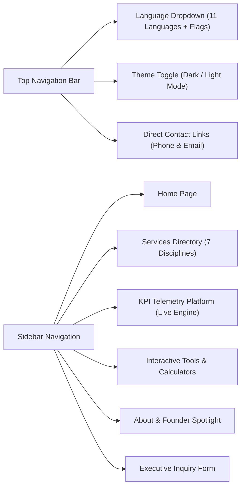

# INFO TECH MICROSYSTEMS - End-User Guide & Interactive Manual

**Document Version:** 2.4.0  
**Effective Date:** September 2026  
**Audience:** Enterprise Clients, Prospective Partners, Technology Leaders, Audit Teams

[← Back to Main README](README.md) • [Architecture & Modularization](docs/architecture_and_modularization.md) • [Developer Guide](docs/developer_guide.md) • [Deployment Guide](docs/deployment_guide.md) • [License](docs/LICENSE.md)

---

## 1. Welcome to INFO TECH MICROSYSTEMS

Welcome to the official enterprise web portal and interactive engineering suite for **INFO TECH MICROSYSTEMS**. Headquartered in Ottawa, Ontario, Canada, INFO TECH MICROSYSTEMS is an elite engineering consultancy founded by **Sudarsha Wijenayake** to bridge the gap between high-level technology strategy and production-grade software delivery.

This manual provides an in-depth walkthrough of all user capabilities, online tools, telemetry views, and configuration options available on this platform.

---

## 2. Global Navigation & Accessibility Controls

The top header and collapsible sidebar provide intuitive navigation across the entire suite:

### 2.1 Language & Country Flag Selector
*   Located at the top right of the navigation header.
*   Displays the active language accompanied by its national flag (e.g. `🇺🇸 English`, `🇨🇳 中文 (简体)`, `🇪🇸 Español`, `🇸🇦 العربية`).
*   **Automatic Browser Detection**: Brand new visitors automatically receive their native language based on their browser settings.
*   **Persistent Caching**: If you change the language, your preference is saved in local storage (`itm_language`) and restored on subsequent visits.
*   **Right-to-Left (RTL) Support**: Selecting Arabic automatically switches the entire website layout to RTL reading orientation.

### 2.2 Dark & Light Theme Switcher
*   Click the **Sun / Moon** icon in the header to alternate between the high-contrast cyber dark mode and the modern executive light mode.
*   Your theme selection is instantly applied and persisted across sessions.

---

## 3. The 7 Dedicated Enterprise Services

Explore in-depth architectural specifications and delivery methodologies for each discipline:

| Service # | Offering Title | Focus Areas | Key Deliverables |
| :---: | :--- | :--- | :--- |
| **01** | **[Software Product Development & Maintenance](services/software-development)** | Modern Web, Cloud SaaS, Microservices, Mobile Apps | Full Git code, ADRs, CI/CD pipelines, automated test suites, Swagger docs |
| **02** | **[Architectural & Lifecycle Consulting](services/software-consulting)** | Requirements, Architecture, Testing, Support, Audits | Software Requirements Spec (SRS), system blueprints, TCO/ROI models |
| **03** | **[Workforce & Team Technical Training](services/workforce-training)** | Full-Stack, TDD, SDET, Cloud Native, DevOps | Custom sandboxes, interactive code labs, competency assessment matrices |
| **04** | **[Quality Assurance & Test Engineering](services/quality-assurance)** | Shift-left QA, Playwright, Cypress, Load & Security | Master Test Strategy, automated regression harness, k6 load benchmarks |
| **05** | **[Technical Staffing & Talent Recruitment](services/technical-recruitment)** | Elite Developers, SDETs, Scrum Masters, Tech Leads | Architect-reviewed candidate dossiers, live coding scores, 90-day guarantee |
| **06** | **[Software KPIs & Process Audits](services/kpis-and-audits)** | DORA metrics, code debt analysis, compliance reviews | DORA telemetry dashboards, SonarQube audit reports, tech due diligence |
| **07** | **[Personnel Performance Management](services/performance-management)** | Competency frameworks, 360 reviews, retention | Engineering career ladders, 1-on-1 guides, retention risk radar maps |

---

## 4. Interactive Engineering Tools & Calculators (`/tools`)

The **Tools & Calculators** suite provides instant, browser-based evaluation across four interactive tabs:

### 4.1 Tab 1: DORA & Velocity Health Calculator
*   **Input Sliders**: Adjust your team's current **Deployment Frequency**, **Lead Time for Changes**, **Change Failure Rate (CFR)**, **Mean Time to Restore (MTTR)**, **Test Coverage**, and **Defect Escape Rate**.
*   **Instant Scoring**: Computes your DevOps tier (**Elite Performer**, **High Performer**, **Medium Performer**, or **Low Performer**) and assigns a letter grade (**A+** down to **C-**).
*   **Targeted ITM Recommendation**: Generates tailored architectural and CI/CD remediation advice based on your weakest metric.

### 4.2 Tab 2: QA Strategy & Architecture Audit Matrix
*   **24-Point Verification Checklist**: Review critical capabilities across 4 categories:
    1.  *Software Architecture & Scalability Audit*
    2.  *Quality Assurance & Test Automation Audit*
    3.  *Security, Compliance & Audit Trail Matrix*
    4.  *Engineering Process & Governance Audit*
*   **Maturity Scorecard**: Live percentage tracker recalculates readiness in real time.
*   **One-Click Report Copy**: Click **"Copy Audit Report"** to generate a formatted text summary with timestamps and pass/fail indicators directly to your clipboard.

### 4.3 Tab 3: Squad Capacity & Staffing Estimator
*   **Resource Modeling**: Configure the number of **Developers**, **QA Automation Engineers (SDETs)**, and **Project Managers / Scrum Masters**, along with your **Sprint Cadence** (1 to 4 weeks).
*   **Throughput Forecasting**: Predicts total story points delivered per sprint and per month.
*   **Dev-to-QA Health Check**: Assesses staffing balance (e.g. *Balanced QA Safety*, *Moderate QA Load*, or *High Bottleneck Risk*).

### 4.4 Tab 4: Enterprise Software KPI Reference Catalog
*   A standardized directory of 10 mission-critical software metrics, providing formal **Calculation Formulas**, **Google Cloud DORA Target Benchmarks**, and **Executive Business Justifications**.

---

## 5. Live Enterprise KPI Governance Platform (`/kpi`)

The **KPI Telemetry Platform** simulates a real-time enterprise monitoring center powered entirely by the browser's IndexedDB database:

### 5.1 Multi-Dimensional Filter Bar
Drill down across your engineering portfolio:
*   **Product Line**: *Enterprise Core Banking*, *HealthTech Portal*, *OmniChannel Commerce*, etc.
*   **Architecture Component**: *Auth & Gateway*, *Ledger Service*, *Payment Gateway*, *Reporting Engine*, etc.
*   **Sprint Cadence & Release Target**: Filter across active sprints and upcoming minor/major releases.
*   **Time Range**: 30-Day, 90-Day, or 180-Day historical telemetry windows.

### 5.2 Six Dedicated View Perspectives
1.  **Executive Scorecard**: DORA tier badges, release stability, deployment velocity, and overall test distribution.
2.  **Quality & Defects**: Defect aging buckets (P1 to P4), Defect Removal Efficiency (DRE), and Mean Time to Detect (MTTD).
3.  **Risk & Release Gating**: Blast radius assessments, component coupling indices, and flaky test quarantine counts.
4.  **Automation & Performance**: P95 latency benchmarks, API response thresholds, and test automation ROI.
5.  **Productivity & Velocity**: Sprint burndown rates, story point velocity, and PR review turnaround durations.
6.  **Governance & SLAs**: Compliance gate violations, SOC2 control status, and SLA breach tracking.

### 5.3 Metric Justification & Explainability Modals
*   Click **"Why This Metric Matters"** or **"Target Deviation"** on any KPI card to open an interactive audit modal detailing:
    *   *Mathematical Formula*
    *   *Target vs. Actual Deviation*
    *   *Root-Cause Analysis*
    *   *Actionable Remediation Checklist*

---

## 6. Executive Contact & Inquiry Submission

Ready to engage on a formal project, schedule an architecture audit, or discuss talent recruitment?

1.  Navigate to **[Contact Us](contact)**.
2.  Complete the secure executive inquiry form:
    *   *Full Name*, *Corporate Email*, *Direct Phone*, *Organization*
    *   *Service Offering Required* (select from the 7 disciplines or comprehensive turnkey)
    *   *Engagement Timeline* and *Project Budget Scope*
    *   *Technical Details & Requirements*
3.  Click **"Send Message to Sudarsha"**.
4.  The system records the inquiry, provides a pre-formatted email launch action, and enables one-click clipboard copying for direct delivery to `info.tech.microsystems.ca@gmail.com` (CC: `sudarsha.wijenayake@gmail.com`).

---

  © 2026 INFO TECH MICROSYSTEMS. For technical inquiries, call +1 613 266 5285.

