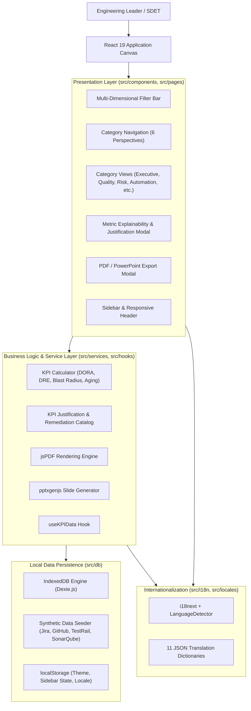
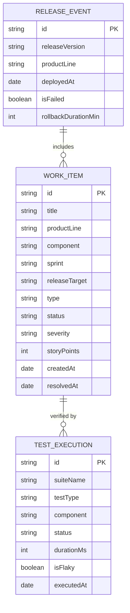

# System Architecture & Modularization

**Document Version:** 1.0.0 (Open Source Edition)  
**System Classification:** Client-Side Single Page Application (SPA) & Telemetry Engine  
**Core Technologies:** React 19, TypeScript, Vite 8, Tailwind CSS v4, Dexie.js (IndexedDB), jsPDF, pptxgenjs

[← Back to Main README](../README.md) • [User Guide](user_guide.md) • [Developer Guide](developer_guide.md) • [Design System](design_system.md) • [License](LICENSE.md)

---

## 1. Architectural Philosophy

The **ITM Quality Engineering KPI & Data Mining Platform** is architected as an **offline-first, zero-backend, client-side analytical platform**. 

Key design principles:
*   **Privacy-by-Design**: Telemetry computation, slicing, and dice operations occur directly in the browser's IndexedDB engine. No proprietary metrics leave the local client.
*   **Layered Separation of Concerns**: Clean boundaries between UI presentation, analytical calculation services, persistence layers, and export generators.
*   **Reactive Telemetry Queries**: Real-time reactive data subscription connecting Dexie.js queries to React state.
*   **High-Fidelity Document Generation**: Client-side document synthesizers generating branded PDF and PowerPoint assets without server rendering pipelines.

---

## 2. High-Level System Architecture

---

## 3. Layered Component Architecture

| Layer | Path | Responsibilities | Key Technologies |
| :--- | :--- | :--- | :--- |
| **Presentation** | `src/pages/`, `src/components/kpi/` | Renders dashboard views, cards, filter bars, modals, and charts. | React 19, Tailwind CSS v4, Lucide Icons |
| **Business Logic** | `src/services/` | Telemetry formulas (DORA, DRE, MTTD, MTTR), rating classification, and justification data. | Pure TypeScript Services |
| **Export Engines** | `src/services/kpiPdfExportService.ts`, `kpiPptxExportService.ts` | Translates live KPI state into pixel-perfect PDF and PowerPoint slides. | jsPDF, jspdf-autotable, pptxgenjs |
| **Persistence** | `src/db/` | Defines client-side database schema, stores work items and test runs, and seeds initial data. | Dexie.js (IndexedDB) |
| **Internationalization** | `src/i18n/`, `src/locales/` | Language detection, LTR/RTL text direction, and fallback resolution across 11 languages. | i18next, react-i18next |
| **Data Contracts** | `src/types/` | Strong typing for KPI records, filter parameters, and export specifications. | TypeScript Interfaces |

---

## 4. Telemetry Data Model (IndexedDB Schema)

The database schema defined in `src/db/kpiDatabase.ts` models enterprise ALM data:

---

## 5. Document Export Engine Architecture

The platform includes a client-side document synthesis engine:

1. **Catalog Preparation**: Collects all active metrics across categories, resolving localized titles, actual values, target thresholds, and status classifications.
2. **Visual Matching**: Uses identical semantic hex codes (`#10b981` Emerald for Optimal, `#f59e0b` Amber for Warning, `#f43f5e` Rose for Breach) as seen in the web UI.
3. **PDF Generation (`kpiPdfExportService.ts`)**:
   - Creates a cover page with scope metadata.
   - Generates responsive two-column grid cards with colored status pills and justification details.
4. **PowerPoint Generation (`kpiPptxExportService.ts`)**:
   - Generates 16:9 widescreen presentation slides.
   - Creates a title slide followed by dedicated slides for each operational category.
   - Places formatted cards with rounded rectangular status badges.
