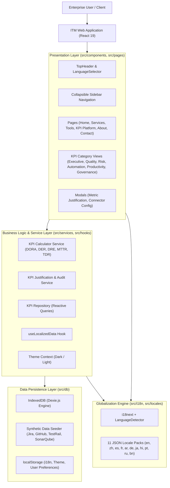
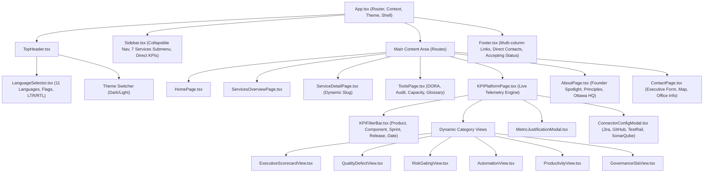
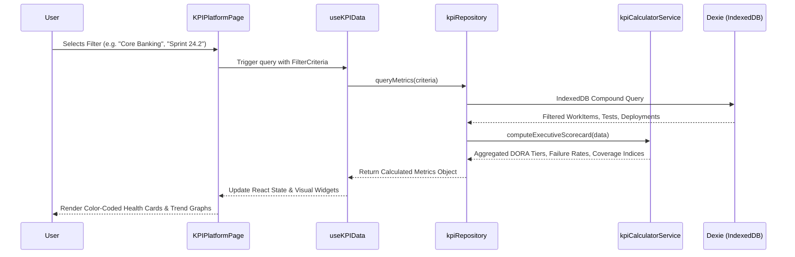

# Overall System Architecture & Modularization

**Document Version:** 2.4.0  
**Effective Date:** September 2026  
**System Classification:** Enterprise Web Application & KPI Telemetry Engine

[← Back to Main README](../README.md) • [User Guide](../USER_GUIDE.md) • [Developer Guide](developer_guide.md) • [Design System](design_system.md) • [License](LICENSE.md)

---

## 1. Executive Architecture Summary

**INFO TECH MICROSYSTEMS Web & Telemetry Suite** is an enterprise-grade Single Page Application (SPA) designed to showcase corporate service disciplines, provide interactive engineering calculators, and deliver a client-side enterprise KPI governance platform.

The application adheres to clean architecture principles:
*   **Modular Componentization**: Strict decoupling of presentation components, business computation services, persistence layers, and internationalization adapters.
*   **Zero-Server Telemetry Simulation**: Full-fidelity database operations executed natively in the client browser via **IndexedDB (Dexie.js)** with 10,000+ synthetic records.
*   **Isomorphic Globalization**: 11-language locale subsystem with runtime switching, fallback chains, and bidirectional layout handling.
*   **High-Contrast Theming**: Cyberpunk neon dark mode and high-contrast light mode governed by reactive theme providers.

---

## 2. High-Level Architecture Diagram

---

## 3. Layered Separation of Concerns

The codebase is organized into distinct functional layers:

| Layer | Directory | Responsibilities | Key Technologies |
| :--- | :--- | :--- | :--- |
| **Presentation** | `src/pages/`, `src/components/` | UI rendering, user interaction, modal state, responsiveness, and ARIA accessibility. | React 19, Tailwind CSS v4, Lucide Icons |
| **State & Hooks** | `src/context/`, `src/hooks/` | Global themes, cached language selection, localized data translation, reactive KPI querying. | React Context, Custom Hooks |
| **Business Logic** | `src/services/` | Telemetry aggregation, statistical computations, DORA tier classification, defect escape formulas, SLA compliance analysis. | TypeScript Pure Services |
| **Persistence** | `src/db/` | Client-side schema definitions, indexing, automated data seeding, wipe/reset capabilities. | Dexie.js (IndexedDB wrapper) |
| **Internationalization** | `src/i18n/`, `src/locales/` | Language detection, LTR/RTL attribute switching, JSON property dictionaries, fallback resolution. | i18next, LanguageDetector |
| **Data Contracts** | `src/types/` | Strong typing for services, KPI records, test executions, Jira work items, audit checklists, and contact inquiries. | TypeScript Interfaces & Types |

---

## 4. Modular Component Hierarchy

---

## 5. Offline-First IndexedDB Telemetry Engine

Unlike traditional portfolio websites, the ITM platform incorporates a fully working client-side analytics database engine:

### 5.1 Schema Architecture (`src/db/kpiDatabase.ts`)
*   **`workItems`**: Jira/Azure DevOps epics, stories, and bugs with severity, status, story points, cycle times, component tags, and product associations.
*   **`testExecutions`**: TestRail/Xray test runs with pass/fail outcomes, execution duration, test type (Unit, Integration, E2E, Security, Perf), and failure timestamps.
*   **`deployments`**: GitHub Actions/GitLab release records with lead times, commit hashes, failure indicators, and MTTR rollback durations.
*   **`codeQualityScans`**: SonarQube quality gate indices, branch coverage percentages, technical debt days, and duplicated lines.
*   **`connectors`**: Configuration status, sync cadences, and connectivity state for mocked external ALM systems.

### 5.2 Seeding & Lifecycle
*   Upon first launch, [`seeder.ts`](file:///c:/Users/Developer/Documents/GitHub/ITMWebSite/src/db/seeder.ts) deterministically populates the browser's IndexedDB instance with over **2,500 active work items, 4,000 test runs, and 120 deployment cycles**.
*   The "Reset Demo Data" action instantly purges the local database and reseeds standard enterprise distributions.
*   All queries leverage compound indexes (e.g. `[productId+component]`, `[sprintCadence+releaseTarget]`) ensuring sub-10ms UI reactivity even with thousands of records.

---

## 6. Telemetry Calculation Pipeline

---

## 7. Extensibility & Design Patterns

The architecture incorporates key design patterns that simplify ongoing extension:

1.  **Repository Pattern**: Data querying logic is cleanly encapsulated inside [`kpiRepository.ts`](file:///c:/Users/Developer/Documents/GitHub/ITMWebSite/src/services/kpiRepository.ts), preventing direct database leakage into visual UI components.
2.  **Strategy Pattern**: Service methodologies and capabilities follow standardized schemas across all 7 disciplines, allowing new enterprise offerings to be added via JSON configurations without altering page templates.
3.  **Adapter Pattern**: The [`useLocalizedData`](file:///c:/Users/Developer/Documents/GitHub/ITMWebSite/src/hooks/useLocalizedData.ts) hook acts as a transparent adapter between raw baseline data records and active i18next translation resources.
4.  **Observer Pattern**: Interactive filters emit criteria events that trigger reactive re-computation across all child category views.

---

  Document maintained by INFO TECH MICROSYSTEMS Architecture Governance Board.

