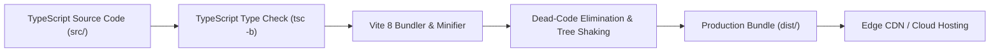

# Production Deployment & Hosting Guide

**Document Version:** 2.4.0  
**Effective Date:** September 2026  
**Target Environments:** AWS CloudFront / S3, Vercel, Netlify, Cloudflare Pages, Docker / Nginx

[← Back to Main README](../README.md) • [User Guide](../USER_GUIDE.md) • [Developer Guide](developer_guide.md) • [Architecture & Modularization](architecture_and_modularization.md) • [License](LICENSE.md)

---

## 1. Overview & Build Pipeline

The INFO TECH MICROSYSTEMS web suite compiles into an optimized, zero-dependency static artifact bundle containing pre-minified HTML, CSS, JavaScript chunks, and static media assets.



---

## 2. Production Build Execution

To generate the distribution bundle, run:

```bash
npm run build
```

This executes `tsc -b && vite build`, performing two critical verification gates:
1.  **TypeScript Static Analysis**: Guarantees zero type mismatches or missing properties across all services and components.
2.  **Vite Bundling**: Compiles JSX/TSX into high-speed ESM chunks, applies CSS tree-shaking via Tailwind CSS v4, and generates content-hashed assets inside the `dist/` directory.

### Build Artifact Verification:
```bash
# Preview production bundle locally
npm run preview
# Serves dist/ at http://localhost:4173 for local audit
```

---

## 3. Cloud Hosting Options

### 3.1 Vercel / Netlify
Because the project is a standard React SPA, deployment to modern edge platforms requires zero configuration:
*   **Build Command**: `npm run build`
*   **Output Directory**: `dist`
*   **Node.js Version**: `20.x` or `24.x`

For client-side routing on Netlify, create a `public/_redirects` file:
```plaintext
/*    /index.html   200
```

For Vercel, create a `vercel.json`:
```json
{
  "rewrites": [{ "source": "/(.*)", "destination": "/index.html" }]
}
```

---

### 3.2 AWS S3 & CloudFront Deployment

For enterprise-grade high availability:
1.  **S3 Bucket**: Configure an Amazon S3 bucket for Static Website Hosting.
2.  **Upload Assets**:
    ```bash
    aws s3 sync dist/ s3://itm-website-prod-bucket --delete
    ```
3.  **CloudFront Distribution**: Create an Amazon CloudFront distribution pointing to the S3 origin.
4.  **SPA Error Page Rule**: Set HTTP Custom Error Response for `404: Not Found` and `403: Forbidden` to redirect to `/index.html` with HTTP Status Code `200: OK`.

---

### 3.3 Containerized Nginx (Docker)

To deploy within an enterprise Kubernetes cluster or Docker container:

```dockerfile
# Stage 1: Build environment
FROM node:24-alpine AS builder
WORKDIR /app
COPY package*.json ./
RUN npm ci
COPY . .
RUN npm run build

# Stage 2: Production web server
FROM nginx:alpine-slim
COPY --from=builder /app/dist /usr/share/nginx/html
COPY nginx.conf /etc/nginx/conf.d/default.conf
EXPOSE 80
CMD ["nginx", "-g", "daemon off;"]
```

**`nginx.conf`**:
```nginx
server {
    listen 80;
    server_name localhost;
    root /usr/share/nginx/html;
    index index.html;

    # Enable gzip compression
    gzip on;
    gzip_types text/plain text/css application/json application/javascript text/xml application/xml;

    location / {
        try_files $uri $uri/ /index.html;
    }

    # Cache static assets with content hashes
    location ~* \.(?:ico|css|js|gif|jpe?g|png|woff2?|eot|ttf|svg)$ {
        expires 1y;
        add_header Cache-Control "public, max-age=31536000, immutable";
    }
}
```

---

## 4. Production Security Headers

Enterprise deployments must enforce the following security headers:

| Header | Recommended Setting | Rationale |
| :--- | :--- | :--- |
| **`Strict-Transport-Security`** | `max-age=63072000; includeSubDomains; preload` | Enforces HTTPS exclusively. |
| **`X-Content-Type-Options`** | `nosniff` | Prevents MIME-type sniffing. |
| **`X-Frame-Options`** | `DENY` | Prevents clickjacking attacks. |
| **`Referrer-Policy`** | `strict-origin-when-cross-origin` | Protects sensitive URL data across origins. |
| **`Content-Security-Policy`** | `default-src 'self'; script-src 'self'; style-src 'self' 'unsafe-inline'; img-src 'self' data: https:; font-src 'self'; connect-src 'self';` | Restricts untrusted script execution. |

---

## 5. Automated CI/CD Pipeline (GitHub Actions)

Create `.github/workflows/deploy.yml`:

```yaml
name: Production CI/CD Pipeline

on:
  push:
    branches: [ main ]
  pull_request:
    branches: [ main ]

jobs:
  build-and-verify:
    runs-on: ubuntu-latest
    steps:
      - name: Checkout Repository
        uses: actions/checkout@v4

      - name: Setup Node.js 24
        uses: actions/setup-node@v4
        with:
          node-version: 24
          cache: 'npm'

      - name: Install Dependencies
        run: npm ci

      - name: Lint Verification
        run: npm run lint

      - name: TypeScript & Production Build
        run: npm run build

      - name: Upload Build Artifacts
        uses: actions/upload-artifact@v4
        with:
          name: itm-production-dist
          path: dist/
```

---

<div align="center">
  <sub>Document maintained by INFO TECH MICROSYSTEMS Cloud & DevOps Infrastructure.</sub>
</div>
