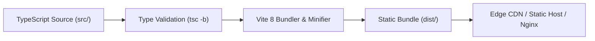

# Production Deployment & Hosting Guide

**Document Version:** 1.0.0 (Open Source Edition)  
**System Classification:** Static Web Application Deployment & Infrastructure Guide  
**Target Environments:** AWS CloudFront / S3, Vercel, Netlify, GitHub Pages, Docker / Nginx

[← Back to Main README](../README.md) • [User Guide](user_guide.md) • [Developer Guide](developer_guide.md) • [Architecture Guide](architecture_and_modularization.md) • [License](LICENSE.md)

---

## 1. Overview & Build Artifacts

The **ITM Quality Engineering KPI & Data Mining Platform** compiles into a fully self-contained, optimized static bundle. Because all telemetry data operations and document exports run client-side via IndexedDB, the application requires **no server-side database or backend runtime**.



---

## 2. Generating the Production Bundle

Run the production build command:

```bash
npm run build
```

This executes `tsc -b && vite build`:
- Compiles TypeScript files and guarantees zero type mismatches.
- Tree-shakes unused CSS via Tailwind CSS v4.
- Generates hashed JavaScript and CSS bundles inside the `dist/` directory.

### Preview the Build Locally:
```bash
npm run preview
```
Serves the `dist/` folder locally at `http://localhost:4173` to verify production assets before deployment.

---

## 3. Hosting & Deployment Options

### 3.1 GitHub Pages

Deploying directly from the repository is straightforward:

1. In `vite.config.ts`, if hosting on a subpath (e.g. `https://<org>.github.io/ITMKPIDashboard/`), ensure the base path is set:
   ```typescript
   export default defineConfig({
     base: '/ITMKPIDashboard/',
     // ...
   });
   ```
2. Build and publish the `dist/` folder to the `gh-pages` branch using the `gh-pages` npm package or a GitHub Actions workflow.

### 3.2 Vercel / Netlify

1. Connect your GitHub repository to Vercel or Netlify.
2. Configure build settings:
   - **Build Command**: `npm run build`
   - **Output Directory**: `dist`
   - **Node Version**: `20.x` or `24.x`

For client-side routing on Netlify, include a `public/_redirects` file:
```plaintext
/*    /index.html   200
```

For Vercel, include a `vercel.json` file in the project root:
```json
{
  "rewrites": [{ "source": "/(.*)", "destination": "/index.html" }]
}
```

### 3.3 Docker & Nginx

A multi-stage `Dockerfile` is included in the project root:

```dockerfile
# Build Stage
FROM node:24-alpine AS builder
WORKDIR /app
COPY package*.json ./
RUN npm install
COPY . .
RUN npm run build

# Production Server Stage
FROM nginx:alpine
COPY --from=builder /app/dist /usr/share/nginx/html
COPY nginx.conf /etc/nginx/conf.d/default.conf
EXPOSE 80
CMD ["nginx", "-g", "daemon off;"]
```

Build and run the container:
```bash
docker build -t itm-kpi-dashboard:latest .
docker run -d -p 8080:80 itm-kpi-dashboard:latest
```
Access the dashboard at `http://localhost:8080`.

### 3.4 AWS S3 & CloudFront

1. **S3 Bucket**: Create an S3 bucket configured for Static Website Hosting.
2. **Sync Assets**:
   ```bash
   aws s3 sync dist/ s3://your-kpi-dashboard-bucket --delete
   ```
3. **CloudFront CDN**: Create a CloudFront distribution pointing to the S3 bucket.
4. **Custom Error Response**: Configure an error page response rule:
   - HTTP Error Code: `404: Not Found`
   - Response Page Path: `/index.html`
   - HTTP Status Code: `200: OK`
