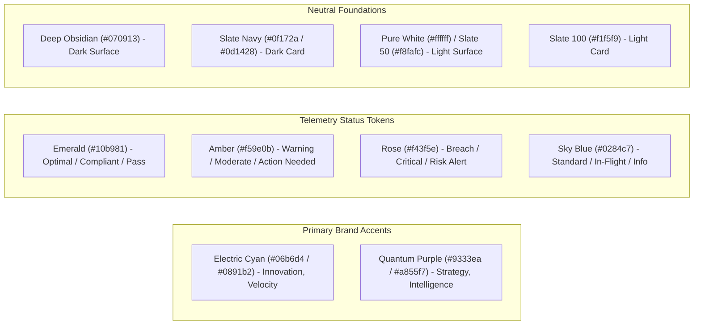

# Design System & UI Specifications

**Document Version:** 2.4.0  
**Effective Date:** September 2026  
**Aesthetic Style:** Cyber-Executive Neon Glassmorphism & High-Contrast Light Mode

[← Back to Main README](../README.md) • [User Guide](user_guide.md) • [Architecture & Modularization](architecture_and_modularization.md) • [Accessibility Guide](accessibility_guide.md) • [License](LICENSE.md)

---

## 1. Visual Identity & Design Principles

The INFO TECH MICROSYSTEMS design system merges high-technology precision with executive authority:
*   **Precision & Rigor**: Sharp, purposeful typography, monospaced data indicators, and mathematical accuracy.
*   **Dual-Aesthetic Harmony**: A high-impact cyber dark mode with luminous neon accents balanced against a pristine, accessible corporate light mode.
*   **Information Hierarchy**: Multi-layer cards, glassmorphic backdrop filters, and clear visual signifiers that draw focus to actionable metrics.
*   **Dual-Coding Statuses**: Status indicators pair color with distinct glyphs and explicit text labels for universal comprehension.

---

## 2. Color Palette & Semantic Tokens



### Color Token Reference Table

| Token Name | Light Mode Value | Dark Mode Value | Usage Context |
| :--- | :--- | :--- | :--- |
| **`primary`** | `cyan-700` (`#0e7490`) | `cyan-400` (`#22d3ee`) | Primary buttons, active tabs, metric values |
| **`secondary`** | `purple-700` (`#7e22ce`) | `purple-400` (`#c084fc`) | Secondary accents, target indicators, badges |
| **`background`** | `white` (`#ffffff`) | `#070913` | Root page canvas |
| **`card`** | `slate-50` / `white` | `slate-900/80` (`#0f172a`) | Glassmorphic surface containers |
| **`border`** | `slate-200` (`#e2e8f0`) | `slate-800` / `cyan-500/20` | Container outlines, subtle separators |
| **`status-optimal`** | `emerald-700` / `emerald-50` | `emerald-400` / `emerald-950/80` | Passing SLAs, <5% CFR, >95% DRE |
| **`status-warning`** | `amber-700` / `amber-50` | `amber-400` / `amber-950/80` | Moderate churn, lagging code reviews |
| **`status-breach`** | `rose-700` / `rose-50` | `rose-400` / `rose-950/80` | SLA violations, blast radius alerts |

---

## 3. Typography & Hierarchy

The platform utilizes three distinct font families to establish hierarchy:

| Font Role | Family | Fallbacks | Primary Purpose |
| :--- | :--- | :--- | :--- |
| **Display Headings** | `'Outfit'` | `sans-serif` | Page titles, hero banners, service headings, metric values |
| **Body & UI Text** | `system-ui` / `'Inter'` | `-apple-system, BlinkMacSystemFont, Segoe UI` | Paragraphs, documentation, navigation items, form inputs |
| **Monospace Telemetry** | `'JetBrains Mono'` / `monospace` | `ui-monospace, SFMono-Regular, Menlo, Consolas` | Formulas, DORA metrics, code badges, timestamps, calculation keys |

### Scale Reference:
*   `text-3xl` / `text-5xl` (`Outfit font-black`): Top-level hero titles
*   `text-xl` / `text-2xl` (`Outfit font-bold`): Section titles and modal headers
*   `text-sm` / `text-base` (`leading-relaxed`): Explanatory descriptions and case studies
*   `text-xs` (`font-mono tracking-wider uppercase`): Category badges and metadata tags

---

## 4. UI Component Library

### 4.1 Buttons
*   **Primary Action**: Gradient pill with shadow:
    `bg-gradient-to-r from-cyan-600 to-blue-600 hover:from-cyan-500 hover:to-blue-500 text-white font-bold rounded-xl shadow-lg shadow-cyan-600/20`
*   **Secondary Action**: Glass outline button:
    `bg-white/80 dark:bg-slate-900/80 border border-slate-200 dark:border-slate-800 hover:border-cyan-400 text-slate-900 dark:text-white rounded-xl`

### 4.2 Interactive Sliders
*   Custom accent color per metric domain:
    *   Deployment Cadence: `accent-cyan-600 dark:accent-cyan-400`
    *   MTTR Recovery: `accent-purple-600 dark:accent-purple-400`
    *   Change Failure Rate: `accent-rose-600 dark:accent-rose-400`

### 4.3 KPI Cards & Status Themes
Governed centrally in [`src/constants/kpiConstants.ts`](file:///c:/Users/Developer/Documents/GitHub/ITMWebSite/src/constants/kpiConstants.ts):
```typescript
export const KPI_STATUS_THEMES = {
  optimal: {
    bg: 'bg-emerald-50 dark:bg-emerald-950/40',
    border: 'border-emerald-300 dark:border-emerald-500/40',
    text: 'text-emerald-700 dark:text-emerald-400',
    badge: 'bg-emerald-100 dark:bg-emerald-900/60 text-emerald-800 dark:text-emerald-300'
  },
  // warning, breach, neutral definitions...
};
```

---

<div align="center">
  <sub>Document maintained by INFO TECH MICROSYSTEMS UI/UX Design System Team.</sub>
</div>
