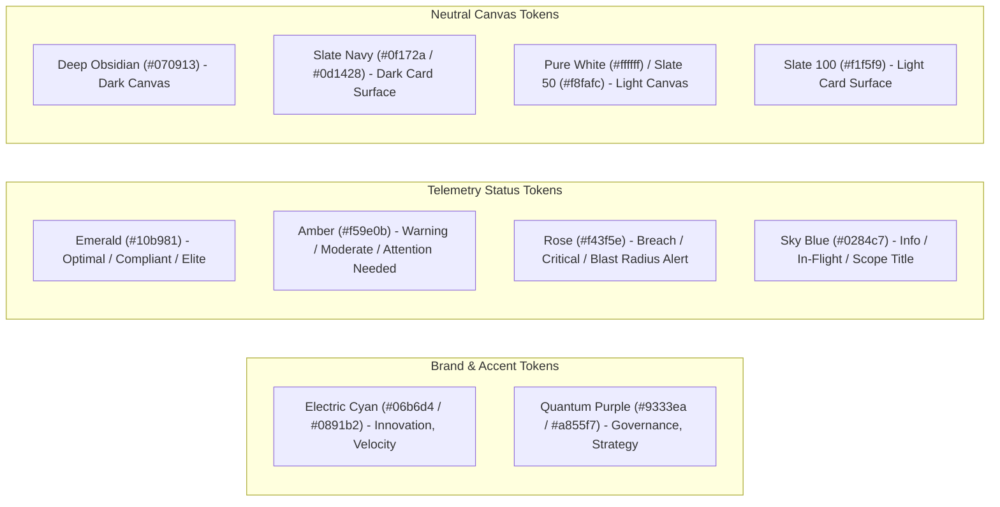

# Design System & UI Specifications

**Document Version:** 1.0.0 (Open Source Edition)  
**Aesthetic Style:** Cyber-Executive Neon Glassmorphism & Accessible Light Mode  
**System Classification:** Open-Source UI Specification & Design Tokens

[← Back to Main README](../README.md) • [User Guide](user_guide.md) • [Architecture Guide](architecture_and_modularization.md) • [Accessibility Guide](accessibility_guide.md) • [License](LICENSE.md)

---

## 1. Visual Philosophy & Design Principles

The **ITM KPI Dashboard** design system balances high-precision telemetry data with executive presentation aesthetics:
*   **Clarity & Scannability**: Metric values, thresholds, and deviations are prominent and easily readable at a glance.
*   **Dual-Aesthetic Excellence**: A cyber-inspired dark mode featuring deep obsidian surfaces and neon accents paired with an executive light mode.
*   **Status Dual-Coding**: Telemetry indicators combine background tints, distinct border styling, semantic icons, and explicit textual status labels (avoiding color-only cues).
*   **Glassmorphic Hierarchy**: Subtle backdrop blur filters, fine border lines, and consistent border-radius hierarchies (`rounded-xl`).

---

## 2. Color Palette & Semantic Tokens

### Semantic Token Reference Table

| Token Name | Light Mode Value | Dark Mode Value | Usage Context |
| :--- | :--- | :--- | :--- |
| **`primary`** | `cyan-700` (`#0e7490`) | `cyan-400` (`#22d3ee`) | Brand highlights, active category tabs, key metric values |
| **`secondary`** | `purple-700` (`#7e22ce`) | `purple-400` (`#c084fc`) | Secondary metrics, target indicators, badges |
| **`background`** | `slate-50` (`#f8fafc`) | `#070913` | Root canvas background |
| **`card`** | `white` (`#ffffff`) | `slate-900/80` (`#0f172a`) | Glassmorphic card surfaces |
| **`border`** | `slate-200` (`#e2e8f0`) | `slate-800` / `cyan-500/20` | Container boundaries and subtle dividers |
| **`status-optimal`**| `emerald-600` (`#059669`) | `emerald-400` (`#34d399`) | Passing SLAs, DORA Elite status, low defect escape |
| **`status-warning`**| `amber-600` (`#d97706`) | `amber-400` (`#fbbf24`) | Moderate defect churn, approaching SLA breach thresholds |
| **`status-breach`** | `rose-600` (`#e11d48`) | `rose-400` (`#fb7185`) | SLA violations, blast radius alerts, critical defects |

---

## 3. Typography & Monospaced Telemetry

The platform pairs a modern geometric display typeface with clean monospaced font stacks:

| Role | Font Family | Fallback | Primary Usage |
| :--- | :--- | :--- | :--- |
| **Display & Headings** | `'Outfit'` | `sans-serif` | Page titles, category headers, metric values |
| **Interface Body** | `system-ui` / `'Inter'` | `-apple-system, BlinkMacSystemFont, Segoe UI` | Descriptions, modal text, filter options |
| **Monospace Telemetry**| `'JetBrains Mono'` | `ui-monospace, Menlo, Consolas, monospace` | Math formulas, DORA metric scores, timestamps, commit hashes |

---

## 4. Metric Card Component Pattern

Every KPI card follows a standardized visual rhythm:

1. **Card Header**:
   - Category or metric title with subtle icon glyph.
   - Status badge (e.g. `OPTIMAL`, `WARNING`, `BREACH`) with matching semantic background tint and border.
2. **Metric Body**:
   - Primary metric figure in large display typography.
   - Sub-label indicating unit of measurement (e.g., `%`, `days`, `hours`, `score`).
3. **Target Comparison**:
   - Benchmark target indicator (e.g., `Target: < 5.0%`).
   - Deviation percentage pill showing difference against SLA or industry benchmark.
4. **Interactive Action Strip**:
   - "Why This Metric Matters" explainability trigger opening the deep-dive audit modal.
