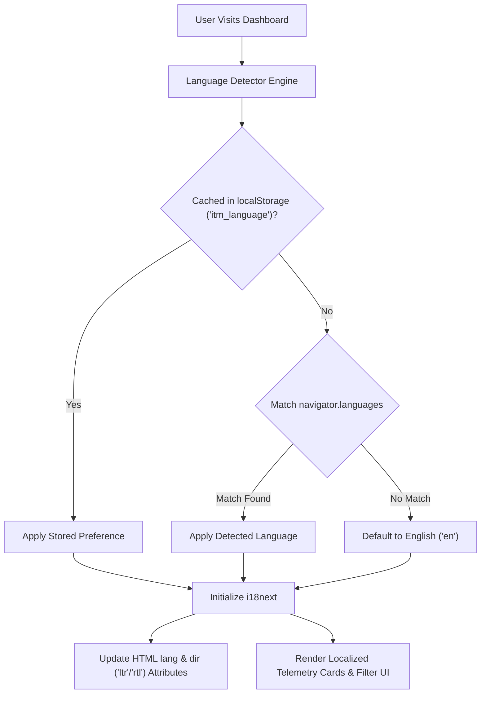

# Globalization & Internationalization (i18n) Guide

**Document Version:** 1.0.0 (Open Source Edition)  
**Standards:** ISO 639-1, W3C Internationalization, Unicode CLDR  
**System Classification:** Open-Source Internationalization & Localization Architecture

[← Back to Main README](../README.md) • [User Guide](user_guide.md) • [Architecture Guide](architecture_and_modularization.md) • [Accessibility Guide](accessibility_guide.md) • [License](LICENSE.md)

---

## 1. Overview

The **ITM KPI Dashboard** is architected for international engineering teams and distributed multinational organizations. The platform provides full native localization across the **11 most widely spoken languages globally**, complete with runtime language detection, persistent caching, and bidirectional Right-to-Left (RTL) layout switching.

---

## 2. Supported Languages & Regional Matrix

| Code | Language | Native Name | Flag | Text Direction | Regional Coverage |
| :---: | :--- | :--- | :---: | :---: | :--- |
| **`en`** | English *(Default)* | English | 🇺🇸 | **LTR** | Global International / North America / UK |
| **`zh`** | Chinese (Simplified) | 中文 (简体) | 🇨🇳 | **LTR** | China, East Asia, Global Diaspora |
| **`hi`** | Hindi | हिन्दी | 🇮🇳 | **LTR** | India, South Asia |
| **`es`** | Spanish | Español | 🇪🇸 | **LTR** | Spain, Latin America |
| **`fr`** | French | Français | 🇫🇷 | **LTR** | France, Canada (Quebec), Francophonie |
| **`ar`** | Arabic | العربية | 🇸🇦 | **RTL** | Middle East, North Africa |
| **`bn`** | Bengali | বাংলা | 🇧🇩 | **LTR** | Bangladesh, West Bengal |
| **`pt`** | Portuguese | Português | 🇧🇷 | **LTR** | Brazil, Portugal |
| **`ru`** | Russian | Русский | 🇷🇺 | **LTR** | Eastern Europe, Central Asia |
| **`de`** | German | Deutsch | 🇩🇪 | **LTR** | Germany, Austria, Switzerland |
| **`ja`** | Japanese | 日本語 | 🇯🇵 | **LTR** | Japan |

---

## 3. Right-to-Left (RTL) Layout Management

For Arabic (`ar`), the application dynamically applies `dir="rtl"` to the root `<html>` element. 

Layout considerations:
*   **Icon Mirroring**: Directional arrows and chevrons automatically reverse orientation using Tailwind's `rtl:rotate-180` utility.
*   **Navigation Placement**: Margins and padding adapt cleanly without breaking visual balance.
*   **Data Grids & Charts**: Metric values and formulas maintain clear reading order.

---

## 4. Contributing Translations

All translation dictionaries reside in the [`src/locales/`](../src/locales/) directory as structured JSON files (e.g., `en.json`, `es.json`, `fr.json`).

To contribute a new translation or enhance existing strings:
1. Locate the JSON file under `src/locales/<lang-code>.json`.
2. Add or update the key-value pairs matching the reference structure in `en.json`.
3. If adding a new language, register the language definition in `src/i18n/languages.ts`.
4. Submit a pull request following our [Contributing Guidelines](../CONTRIBUTING.md).
