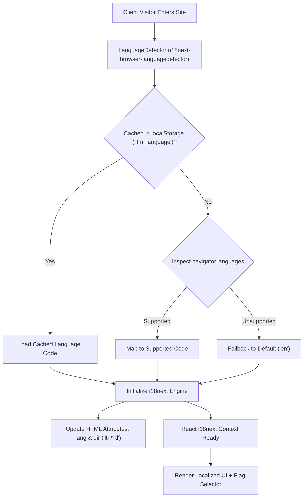

# Globalization & Internationalization (i18n) Guide

**Document Version:** 2.4.0  
**Effective Date:** September 2026  
**Standards:** ISO 639-1, W3C Internationalization, Unicode CLDR

[← Back to Main README](../README.md) • [User Guide](../USER_GUIDE.md) • [Architecture & Modularization](architecture_and_modularization.md) • [Accessibility Guide](accessibility_guide.md) • [License](LICENSE.md)

---

## 1. Globalization Architecture Overview

The INFO TECH MICROSYSTEMS web suite is engineered from the ground up to support international enterprises, multinational engineering squads, and global clients. The platform provides complete localization across the **11 most widely spoken languages in the world**, featuring dynamic runtime switching, automatic browser locale detection, persistent caching, and full Right-to-Left (RTL) bidirectional layout handling.



---

## 2. Supported Languages & Regional Configuration

| Language Code | Language Name | Native Script Name | Country Flag | Text Direction | Target Population / Region |
| :---: | :--- | :--- | :---: | :---: | :--- |
| **`en`** | English *(Default)* | English | 🇺🇸 | **LTR** | Global Enterprise, North America, UK, International |
| **`zh`** | Chinese (Simplified) | 中文 (简体) | 🇨🇳 | **LTR** | China, East Asia, Global Chinese Diaspora |
| **`hi`** | Hindi | हिन्दी | 🇮🇳 | **LTR** | India, South Asia |
| **`es`** | Spanish | Español | 🇪🇸 | **LTR** | Spain, Latin America, North America |
| **`fr`** | French | Français | 🇫🇷 | **LTR** | Canada (Federal / Quebec), France, Francophonie |
| **`ar`** | Arabic | العربية | 🇸🇦 | **RTL** | Middle East, North Africa, Arab World |
| **`bn`** | Bengali | বাংলা | 🇧🇩 | **LTR** | Bangladesh, West Bengal, South Asia |
| **`pt`** | Portuguese | Português | 🇧🇷 | **LTR** | Brazil, Portugal, Global Lusophone |
| **`ru`** | Russian | Русский | 🇷🇺 | **LTR** | Eastern Europe, Central Asia |
| **`de`** | German | Deutsch | 🇩🇪 | **LTR** | Germany, Austria, Switzerland, Central Europe |
| **`ja`** | Japanese | 日本語 | 🇯🇵 | **LTR** | Japan, Global Tech Enterprises |

---

## 3. Runtime Detection & Persistent Caching

### 3.1 Detection Strategy
The internationalization engine (`src/i18n/index.ts`) configures a multi-tier detection order:
1.  **`localStorage` Cache**: Looks for key `itm_language`. If the user has ever explicitly chosen a language, that choice takes absolute precedence.
2.  **`navigator.languages`**: For first-time visitors, the browser's preferred language string (e.g. `zh-CN`, `es-MX`, `fr-CA`) is parsed, stripped to its ISO 639-1 code (`zh`, `es`, `fr`), and matched against supported languages.
3.  **Default Fallback**: If no match is found, the system defaults cleanly to `en` (English).

### 3.2 HTML Document Synchronization
When switching languages, the system dynamically synchronizes the root document element attributes:
```typescript
export const updateHtmlAttributes = (langCode: string) => {
  if (typeof document !== 'undefined') {
    const code = supportedCodes.includes(langCode) ? langCode : DEFAULT_LANGUAGE;
    document.documentElement.lang = code;
    document.documentElement.dir = getLanguageDirection(code);
  }
};
```

---

## 4. Right-to-Left (RTL) Layout Management

For Arabic (`ar`), the document direction attribute is set to `dir="rtl"`. The application incorporates Tailwind RTL utilities to ensure flawless visual flow:

*   **Directional Icons**: Navigation arrows and chevrons automatically rotate 180 degrees using `rtl:rotate-180` and `rtl:group-hover:-translate-x-1`.
*   **Border Accents**: Left borders (`border-l-2`) adapt naturally or flip to maintain hierarchy.
*   **Alignment**: Flex layouts and text alignment respect the native reading flow of the active script.

---

## 5. Rich Data & Object Translation (`useLocalizedData`)

To eliminate hardcoded strings in complex domain entities, the platform provides dedicated custom hooks in [`src/hooks/useLocalizedData.ts`](file:///c:/Users/Developer/Documents/GitHub/ITMWebSite/src/hooks/useLocalizedData.ts):

### 5.1 Service Model Translation (`useLocalizedServices`)
Translates multi-paragraph corporate specifications without mutating underlying data contracts:
```typescript
const services = useLocalizedServices();
// services[0].title -> "定制软件产品开发、功能增强与持续维护" (zh)
// services[0].tagline -> "现代 Web、多层架构、企业级、云 SaaS、移动及微服务架构的端到端工程交付。" (zh)
// services[0].capabilities -> Array of translated capability objects with bullet points
```

### 5.2 QA Audit & KPI Translation
*   `useLocalizedAuditTemplates()`: Translates all 4 checklist categories and 24 verification items.
*   `useLocalizedCoreKPIs()`: Translates formulas, benchmarks, category badges, and business impact rationale.

---

<div align="center">
  <sub>Document maintained by INFO TECH MICROSYSTEMS Internationalization Working Group.</sub>
</div>
