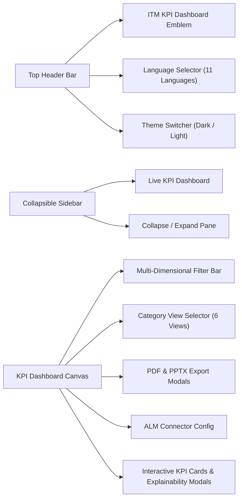

# ITM Quality Engineering KPI Platform - User Guide & Interactive Manual

**Document Version:** 1.0.0 (Open Source Edition)  
**System Classification:** Open-Source Quality Engineering Telemetry & KPI Platform  
**Target Audience:** QA Leads, SDETs, Engineering Managers, DevOps Engineers, and Agile Teams

[← Back to Main README](../README.md) • [Architecture Guide](architecture_and_modularization.md) • [Developer Guide](developer_guide.md) • [Deployment Guide](deployment_guide.md) • [License](LICENSE.md)

---

## 1. Overview

The **ITM Quality Engineering KPI & Data Mining Platform** is a standalone, client-side analytics suite engineered to monitor, evaluate, and elevate software delivery performance. It translates raw engineering data (work items, bug reports, automated test runs, and release pipelines) into clear, actionable executive scorecards and tactical quality metrics.

The platform runs completely within your web browser using a deterministic **IndexedDB** database engine (Dexie.js), ensuring complete data privacy with zero external telemetry transmission.

---

## 2. Navigation & Interface Layout

### 2.1 Top Navigation Bar
- **Language Selector**: Switch between 11 supported international languages with country flag indicators.
- **Theme Switcher**: Toggle between the high-contrast cyber dark mode and modern crisp light mode.
- **Corporate Location & Support Info**: Quick reference contact information.

### 2.2 Collapsible Sidebar
- Features a dual desktop mode (full-width or compact icon-only rail) and a mobile slide-out drawer.
- Provides persistent layout state saved to your browser's local storage (`itm_sidebar_collapsed`).

---

## 3. Multi-Dimensional Filter Bar

Fine-tune the scope of data analyzed across your engineering organization:

| Filter Dimension | Available Options | Impact on Metrics |
| :--- | :--- | :--- |
| **Product Line** | *All Products*, *Enterprise Core Banking*, *HealthTech Patient Portal*, *OmniChannel Commerce* | Filters work items, defect pools, and test suites by product scope. |
| **Component** | *All Components*, *Auth & Gateway*, *Ledger Service*, *Payment Gateway*, *Reporting Engine* | Drills down into specific microservices and architectural boundaries. |
| **Sprint Cadence** | *All Sprints*, *Sprint 24*, *Sprint 25*, *Sprint 26*, *Sprint 27* | Isolates sprint velocity, burndown, and work item completion. |
| **Release Target** | *All Releases*, *v2.4.0*, *v2.5.0-RC*, *v3.0.0-Beta* | Evaluates release readiness and gating thresholds. |
| **Time Window** | *Last 30 Days*, *Last 90 Days*, *Last 180 Days* | Adjusts trend timelines, defect aging, and historical lead times. |

---

## 4. The 6 Analytical Perspectives

The platform categorizes telemetry into 6 dedicated operational perspectives:

### 4.1 Executive Scorecard
- **DORA Performance Metrics**: Deployment Frequency, Lead Time for Changes, Change Failure Rate (CFR), and Mean Time to Restore (MTTR).
- **DevOps Tier Rating**: Automated categorization into *Elite*, *High*, *Medium*, or *Low* performer tiers with benchmark comparison.
- **Overall Quality Health Index**: Composite score blending defect density, test coverage, and release stability.

### 4.2 Quality & Defect Governance
- **Defect Severity Distribution**: Real-time breakdown across Critical (P1), High (P2), Medium (P3), and Low (P4) bugs.
- **Defect Removal Efficiency (DRE)**: Ratio of defects found before release versus total defects discovered.
- **Defect Aging Buckets**: Distribution of open defects across time intervals (<7 days, 8-30 days, >30 days).
- **Discovery Origin Tracking**: Distinguishes between unit test catches, automation harness catches, exploratory testing, and production escapes.

### 4.3 Risk & Release Gating
- **Blast Radius Analysis**: Identifies high-risk architectural modules with tight coupling or broad downstream dependencies.
- **Automated Gating Criteria**: Evaluates blocking issues against pre-set release criteria before promotion to staging or production.
- **Flaky Test Quarantine**: Highlights non-deterministic tests requiring immediate triage.

### 4.4 Automation & Performance
- **Test Automation Pyramid**: Visual distribution of Unit, Integration, API, and End-to-End (E2E) automated tests.
- **Pass Rate Trends**: Time-series view of test stability across CI/CD execution runs.
- **API Performance Latencies**: P95 and P99 latency tracking against defined Service Level Objectives (SLOs).

### 4.5 Productivity & Delivery Flow
- **Sprint Burndown Velocity**: Real-time progress against committed story points.
- **Cycle Time & Lead Time**: Measures elapsed time from commit to production deployment.
- **Pull Request Review Turnaround**: Average turnaround time for code reviews and PR approvals.

### 4.6 Governance, SLAs & Leading Indicators
- **Production SLA Compliance**: Uptime and error budget tracking against 99.9% availability targets.
- **Leading vs. Lagging Indicators**: Early warning signals (e.g., test coverage drops, code churn spikes) before production incidents emerge.
- **Compliance & Audit Readiness**: Adherence to quality gates, SOC2 controls, and internal engineering standards.

---

## 5. Metric Explainability & Audit Modals

Every KPI card in the platform features deep root-cause explainability:

1. Click on any metric card to open its **Metric Justification Modal**.
2. Review:
   - **Mathematical Calculation Formula**: The exact industry-standard formula used to derive the score.
   - **Target vs. Actual Deviation**: Visual indicators detailing whether the metric is Optimal, Approaching Target, or in Breach.
   - **Root-Cause Analysis**: Practical context on why a deviation occurs (e.g., flaky infrastructure, complex PRs, insufficient unit tests).
   - **Actionable Remediation Checklist**: Step-by-step best practices to bring the metric back into the optimal zone.

---

## 6. Publication-Ready Executive Exports (PDF & PPTX)

Export your current dashboard view into polished executive presentations:

1. Click **"Export PDF"** or **"Export PPTX"** in the top action bar.
2. The export engine automatically:
   - Captures the active filter scope (product line, component, release, date range).
   - Groups all KPIs into their respective operational categories.
   - Renders each metric card with its exact color-coded status badge (Optimal green, Warning amber, Breach rose).
   - Generates a standalone, presentation-ready `.pdf` or `.pptx` file directly in your browser.

---

## 7. Data Connectors & Reset

- **Connectors**: Click **"Configure Connectors"** to simulate and configure ALM connections (Jira, GitHub Actions, TestRail, SonarQube).
- **Reset Database**: Need a fresh batch of synthetic telemetry? Use the **"Reset Data"** option to reseed the local IndexedDB database with clean benchmark records.
